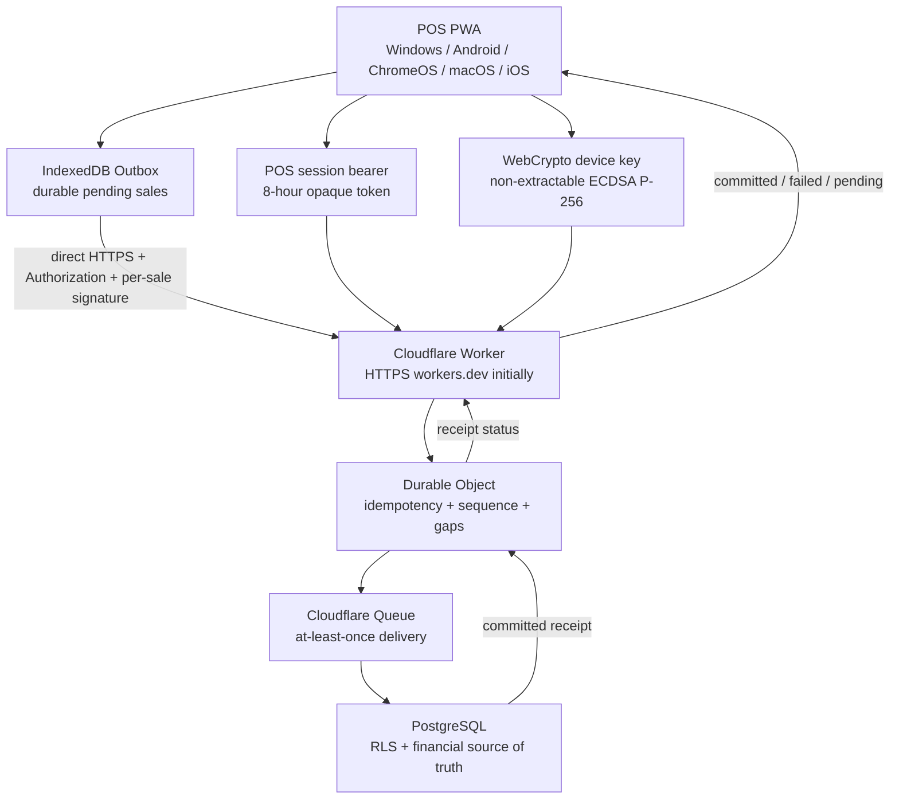

# PRODX-POS Direct PWA → Cloudflare Worker Device Authentication

- **Status:** Draft — owner decision required before implementation
- **Date:** 2026-11-16
- **Repository baseline:** `origin/main` at `eb9da5b97411cae1356896ec271793fafa799679`
- **Scope:** Direct browser/PWA-to-Worker Edge Sync for a mixed-OS POS fleet
- **Safety:** Design only. No application code, database, DNS, Cloudflare, Vercel, secrets, or production resources changed.

## 1. Executive decision

The product direction is **PWA → Cloudflare Worker directly**, without the Vercel Preview proxy in the Edge Sync data path. Vercel remains the PWA hosting platform and continues serving unrelated application APIs.

The previously proposed universal browser mTLS design is **not currently deployable on the connected Cloudflare account**:

- The connected Cloudflare account is `3c0c1c843f861164db9de3fb31f062f5`.
- Read-only Cloudflare API inspection returned one standard account and **zero active zones**.
- The current Worker config uses `workers_dev: true`; it has no custom-domain route.
- Cloudflare Zone-level mTLS requires a hostname in an active Cloudflare Zone.
- Cloudflare Access mTLS is a separate feature, requires Enterprise or pay-as-you-go Zero Trust, and is not included in Free.
- Cloudflare-managed client certificates are available on Free/Pro/Business, but the default limit is 100 active certificates per zone. BYOCA requires Enterprise.

The repository also has an explicit Free-plan/no-domain-purchase constraint in `docs/edge-sync-free-plan-device-auth-rfc.md`.

**Recommendation under the currently evidenced constraints:** retain the Direct PWA → Worker data path, but use per-terminal application-layer device signatures with WebCrypto (ECDSA P-256 / SHA-256) as the primary device identity. This is **not mTLS** and must never be described as equivalent to transport-layer mTLS. Keep zone-level mTLS as an optional future transport-hardening layer if an active Cloudflare Zone, device management, certificate quota, and owner approval become available.

If the owner requires true mTLS now, stop before implementation and obtain approval for an existing/new Cloudflare Zone hostname and resolve the device-count/OS provisioning constraints first.

## 2. Evidence from the current repository

The following observations were read from `origin/main`, not inferred from prior conversation:

1. `prodx-pos-edge-sync/src/auth.ts` currently expects `cf-access-jwt-assertion`, verifies a Cloudflare Access JWT, and expects `tenant_id` and `terminal_id` claims. It also has a separate `verifyTerminalCertificate()` function that reads `request.cf.tlsClientAuth`.
2. `prodx-pos-edge-sync/src/index.ts` calls `verifyTerminalCertificate()` for `POST /api/v1/pos/sync-batch`, but `GET /api/v1/catalog` and `GET /api/v1/pos/receipt-status` currently call only `authenticate()`. Terminal identity enforcement is therefore not uniform across the terminal API surface.
3. The current PWA sync factory uses `createProductionSyncApi()`, which calls `VITE_AUTH_API_BASE_URL/api/v1/sync/commands`. It does not call the Edge Worker endpoint.
4. The current PWA `OutboxItem` is a generic `order_transaction | shift_movement | stock_adjustment` item. The Edge Worker expects an `OfflineSale` with sale ID, sequence number, HLC, catalog version, signed price proofs, payload hash, and sale lines. There is no verified production adapter mapping between these contracts.
5. The Edge endpoint currently rejects batches with fewer than 10 sales and more than 50 sales. A PWA outbox can contain fewer than 10 pending sales, so the current contract can strand small queues unless a flush policy or a 1–50 contract is designed.
6. The current POS session token is an opaque 32-byte base64url bearer token. The server stores only its SHA-256 hash in `prodx_sessions`; session lifetime is 8 hours. It is not a Supabase JWT and is not a Cloudflare Access JWT.
7. `prodx_auth_find_session_by_token_hash(text)` exists as a narrow `SECURITY DEFINER` function, but its current grant is for `prodx_app`; it does not currently establish all device/store checks needed by the Edge Worker.
8. `prodx_sessions.device_id` references `prodx_devices.id`. The Edge schema's `terminal_devices.terminal_id` has no declared foreign key to `prodx_devices.id`. The identity mapping between those identifiers and between `tenant_id` and `organization_id` must be made explicit before implementation.
9. `terminal_devices` currently stores certificate fingerprints and certificate validity/revocation fields. It does not store WebCrypto public keys, key IDs, or key lifecycle state.
10. The current Edge body-size check calls `request.text()` before measuring the body. The existing Free-plan device-auth RFC already lists streaming body-cap enforcement, concurrent inventory non-negativity, exact tax arithmetic, and canonical payload alignment as separate required correctness work. Device authentication must not be used to mask those blockers.

## 3. Target topology

### 3.1 Direct data path

No Vercel Function proxies Edge Sync. The browser's TLS connection terminates at Cloudflare, but device identity is proven at the application layer by a per-terminal key.

### 3.2 Why WebCrypto is the current recommendation

- WebCrypto is available to secure contexts across the target browser families.
- A non-extractable private `CryptoKey` can be persisted in IndexedDB; application JavaScript can request signatures but cannot export the private key bytes.
- It does not depend on the browser exposing the OS client-certificate store to PWA JavaScript.
- It works with the current `workers.dev` endpoint and does not require buying a domain or enabling a paid Access mTLS plan.
- It can sign each sale while offline, so the signature remains attached to the sale when the outbox is replayed later.

Limitations must remain explicit:

- Non-extractable does not guarantee hardware-backed storage. Browser/OS implementations may store the key in software.
- Same-origin malicious JavaScript or XSS may invoke the key to sign attacker-chosen payloads even if it cannot export the key.
- Clearing browser storage, profile loss, device reset, or browser migration can destroy the key. Recovery must be an audited re-enrollment, not key recovery from the server.
- Application-layer signatures authenticate the signer of a sale payload; they do not provide TLS handshake client authentication or prevent an unauthenticated TLS connection from reaching the Worker.

## 4. Authentication and authorization contract

### 4.1 Three independent proofs

1. **User/session:** the existing opaque POS session bearer token proves an active user session. Do not send a raw Supabase access JWT to the Edge Worker unless a separate design explicitly authorizes that change.
2. **Device:** the per-terminal WebCrypto public key verifies the signature over each sale.
3. **Business authorization:** PostgreSQL-backed membership, role, store, terminal, and permission checks authorize the operation. No client-provided `tenant_id`, `organization_id`, `store_id`, `terminal_id`, or role claim is authoritative.

### 4.2 Server-derived identity

The Worker must hash the bearer token with SHA-256 and resolve it through a narrowly scoped database authentication function. The function must return only the minimum required identity context and must enforce:

- session exists, is not revoked, and has not expired;
- user is active;
- device is active;
- session organization matches device organization;
- store is active;
- active user/store membership exists;
- device/key enrollment is active and not revoked.

The existing session lookup function is not automatically sufficient: its current result does not include all device/store checks, and its grant is not currently assigned to the Edge runtime role. Prefer a new narrowly scoped `SECURITY DEFINER` function with fixed `search_path`, `REVOKE ALL FROM PUBLIC`, explicit execute grant to the least-privilege Edge role, and integration tests. Do not grant broad SELECT or BYPASSRLS to make authentication work.

The Edge Worker must establish transaction-local tenant context only after it has resolved the trusted session. `tenant_id` must be explicitly mapped to the canonical `organization_id`; `terminal_id` must be explicitly mapped to the session's `prodx_devices.id` or to a separately governed mapping. Do not assume the two IDs are interchangeable without a database invariant.

### 4.3 Device-key registry and lifecycle

Use a dedicated device-key registry (proposed name: `terminal_device_keys`) rather than overloading the existing certificate-fingerprint column. Exact DDL is a later migration decision.

Minimum fields:
- tenant/organization ID and canonical device/terminal ID;
- immutable key ID derived from the public-key fingerprint;
- algorithm fixed to `ECDSA-P256-SHA256`;
- public key in SPKI form;
- lifecycle state: `pending | active | rotated | revoked | expired`;
- `not_before`, `not_after`, `revoked_at`, `created_at`;
- enrollment actor, approval actor, and audit correlation ID.

Required database invariants:
- one key ID maps to one device and one tenant;
- a key cannot be active for multiple devices or tenants;
- state transitions are server-authorized and audited;
- Worker role is read-only for key enrollment data;
- only a tenant-scoped device-admin workflow can enroll, rotate, or revoke keys;
- revocation is effective on the next authoritative verification;
- no direct DELETE of security/audit history.

### 4.4 Enrollment

1. An authorized owner/admin starts enrollment for a specific registered device and store.
2. The server issues a cryptographically random, single-use, short-lived challenge bound to tenant, device, requester, and intended protocol version.
3. PWA generates a non-extractable ECDSA P-256 key pair locally and stores the private `CryptoKey` in IndexedDB.
4. PWA submits the SPKI public key and proof-of-possession signature over the challenge.
5. Server verifies the challenge, device state, requester permission, and proof of possession.
6. Enrollment remains pending until the authorized approval action is recorded.
7. Activation and audit event are committed atomically.
8. The private key is never uploaded, logged, or included in diagnostics.

A terminal must never self-enroll a replacement key using an ordinary sync request.

### 4.5 Rotation and revocation

- Generate a new key locally and enroll it through the same approved challenge flow.
- Permit a bounded overlap window only for the same device and only when explicitly authorized.
- Revoke the old key after the new key has passed a real signed request and receipt-status round trip.
- Lost, stolen, wiped, or compromised devices are revoked immediately.
- Re-enrollment creates a new key identity; do not attempt to recover the old private key from the server.
- Define and test the policy for sales signed offline before a key is revoked but uploaded afterward. Safe default: reject the revoked key, preserve the local outbox, and route affected sales to an audited manual reconciliation process. Do not silently accept based on client timestamps.

## 5. Signed-sale protocol

Use a versioned protocol with fixed algorithm and deterministic byte-level test vectors.

### 5.1 Algorithm

- ECDSA over P-256 with SHA-256 using WebCrypto.
- Private key: non-extractable `CryptoKey`; never serialized or sent to the server.
- Public key: SPKI DER, base64url encoded.
- Signature: WebCrypto ECDSA signature bytes, base64url encoded; protocol must pin the encoding (WebCrypto raw P1363 `r || s`, not ASN.1 DER).
- Key ID: SHA-256 fingerprint of the canonical SPKI bytes.
- Reject algorithm negotiation and unknown protocol versions.

### 5.2 Per-request device proof

All terminal API requests must prove possession of the enrolled key, not only sale mutations. This covers catalog reads and receipt-status reads as well as sync writes.

The PWA sends an `X-PRODX-Device-Proof` compact signed proof with:
- protocol version and registered `key_id`;
- HTTP method and canonical path + query;
- request timestamp and a cryptographically random unique `jti`;
- SHA-256 hash of the POS session token (never the raw token);
- SHA-256 hash of the exact request body (empty hash for GET).

The Worker:
1. Resolves the POS session and device identity from the server-side session record.
2. Loads the public key only for that server-derived tenant/device.
3. Verifies the proof signature, method, URL, body hash, session-token hash, key state, and a narrow timestamp window.
4. Atomically consumes the `jti` in the terminal's Durable Object nonce store with bounded retention; duplicate `jti` values are rejected.
5. Prunes expired nonce rows opportunistically during nonce consumption. Do not introduce a second Durable Object alarm: the current DO has one alarm dedicated to outbox recovery.
6. Proceeds to the endpoint only after all checks pass.

The request proof protects online API calls. Each sale still needs its own durable sale signature created when the sale is enqueued, so offline replay remains verifiable after the request proof expires. A request proof must never be treated as a substitute for per-sale signatures, idempotency, or sequence checks.

The exact header encoding, canonical URL rules, body hashing, nonce retention, and error contract must be specified with shared test vectors. Do not accept caller-supplied public keys or use request headers as a substitute for registry lookup.

### 5.3 Canonical payload

Define one canonicalization contract shared by PWA, Worker, Queue consumer, and PostgreSQL integration tests:

1. Domain-separate by protocol name and version.
2. Bind tenant/organization, device/terminal, sale ID, terminal sequence number, idempotency key, and canonical sale payload.
3. Compute SHA-256 over the canonical object.
4. Sign a domain-separated message containing protocol version, tenant, device, sale ID, sequence number, idempotency key, and payload hash.
5. Exclude only explicitly named transport fields such as `payload_hash` and `device_signature`; do not allow arbitrary omitted fields.
6. Use integer minor currency units and integer tax basis points. Do not sign floating-point monetary values.
7. Persist key ID, algorithm, signature, payload hash, protocol version, and verification outcome in immutable audit metadata.

The exact JSON canonicalization, UTF-8 encoding, domain separator, signature encoding, and sample payloads must be approved as test vectors before code is written. No component may invent its own serialization.

### 5.4 Verification boundary

- Verify session and device binding before accepting the batch.
- Verify every sale signature and payload hash at the Edge boundary before Durable Object enqueue.
- Re-verify immutable signed fields at the trusted origin before financial writes, or use an equivalent cryptographically authenticated internal contract with tests proving the Queue cannot substitute a sale/key identity.
- Continue enforcing price-proof verification, terminal sequence/HLC, idempotency, inventory constraints, and server-authoritative totals independently of the device signature.
- A valid signature never bypasses PostgreSQL constraints or business authorization.

## 6. PWA integration contract

### 6.1 Direct API

Initial endpoint remains the existing Worker route:
- `POST /api/v1/pos/sync-batch`
- `GET /api/v1/pos/receipt-status`
- `GET /api/v1/catalog`

All terminal endpoints must enforce both session and device-key authentication. The operator diagnostics endpoint remains a separate auditor-only contract.

The current PWA production adapter is not compatible with this contract. A new Edge Sync adapter and an explicit domain mapping are required; do not repoint `VITE_AUTH_API_BASE_URL` or silently route all application APIs to the Worker.

| Endpoint | Required proof |
|---|---|
| `GET /api/v1/catalog` | Active POS session + per-request device proof |
| `POST /api/v1/pos/sync-batch` | Active POS session + per-request device proof + signature on every sale |
| `GET /api/v1/pos/receipt-status` | Active POS session + per-request device proof |
| `GET /api/v1/ops/terminal-sync-diagnostics` | Separate tenant-scoped auditor authorization; never trust terminal/user claims supplied by the browser |
| `OPTIONS` preflight | Exact-origin CORS response only; no business data, no receipt creation, no database writes |

The current `cf-access-jwt-assertion` authentication path must not be confused with the POS session. Terminal routes should validate the existing opaque POS session through the narrowly scoped database contract described above. Keep any Cloudflare Access-based operator diagnostics contract separate.

### 6.2 Outbox mapping and batching

Before implementation, map current `OutboxItem` data to `OfflineSale` without inventing missing fields. Required data includes sale ID, terminal sequence, HLC, catalog version, signed price proofs, idempotency key, payload hash, and lines.

The current Edge API requires 10–50 sales, while a PWA may have 1–9 pending sales. The implementation must either:
- change the Edge contract to accept 1–50 sales and update all validation/tests; or
- define a bounded flush policy that cannot indefinitely strand a small queue.

Prefer a 1–50 sale request if DO and Queue limits remain satisfied. This is a contract change and needs regression tests.

### 6.3 Acknowledgement lifecycle

- Persist the sale and its signature in IndexedDB before reporting it as queued.
- `202 Accepted` means Edge/DO/Queue accepted work, not that PostgreSQL committed it.
- Keep the outbox item until receipt status reports `committed`.
- On transient errors, retry with bounded backoff and the same idempotency key and payload hash.
- On permanent authorization/signature/key-revocation errors, stop automatic retries, retain the outbox, and surface an actionable terminal state.
- On browser restart, OS restart, or network return, recover and replay the exact signed payload.
- Never delete or mutate committed financial history to simulate rollback.

### 6.4 CORS and browser boundary

- Allow only exact approved PWA origins (production and separately approved preview origins).
- Explicitly allow required methods and headers; never use wildcard origin for credentialed requests.
- Preflight must reveal no business data and must not create receipts or database effects.
- Do not rely on Cloudflare Access redirects or service-token secrets embedded in PWA JavaScript.
- Test CORS and Authorization behavior on every supported browser/OS combination.
- No client-supplied fingerprint, tenant ID, terminal ID, or public-key ID is trusted without server-side registry verification.

## 7. Mixed-OS support matrix

The PWA uses WebCrypto for device signing, so the browser does not need access to an OS client-certificate store. This is more portable than mTLS for a mixed fleet, but each supported browser still needs real-device tests.

| Platform | Browser target | Key storage expectation | Release status |
|---|---|---|---|
| Windows | Chrome / Edge | Non-extractable WebCrypto key persisted in IndexedDB; hardware backing not assumed | Test required |
| macOS | Safari / Chrome / Edge | Same; verify persistence across restart and PWA/browser contexts | Test required |
| Android | Chrome (managed or standard) | Same; test app data clear, browser update, background/foreground and storage eviction | Test required |
| ChromeOS | Chrome | Same; test managed profile and device wipe behavior | Test required |
| iOS / iPadOS | Safari installed PWA; Chrome only if separately qualified | Same; test WebCrypto key persistence and PWA lifecycle on physical devices | **Highest-risk test gate** |

A non-extractable WebCrypto key is not proof of TPM/Secure Enclave protection. The product must state the assurance level honestly. If hardware-backed key storage is mandatory, a browser-only PWA may not meet the requirement on every OS; a native helper/agent or a restricted managed-device fleet may be required.

## 8. mTLS option retained for future hardening

If the owner later chooses true mTLS:

- Use a dedicated hostname in an active Cloudflare Zone and a Worker Custom Domain/route; do not rely on `workers.dev` for Zone-level mTLS.
- Prefer Cloudflare-managed CA initially. Cloudflare documents a default limit of 100 active client certificates per zone; revocation frees a slot. BYOCA requires Enterprise.
- Enforce client certificates with a host/path-scoped WAF rule checking both `cert_verified` and `cert_revoked`; also restrict the issuer where supported.
- Keep Worker-side fingerprint-to-device mapping as defense in depth.
- mTLS does not replace user/session authorization or per-sale replay/idempotency controls.
- Access mTLS is separate, requires Enterprise or pay-as-you-go Zero Trust, and is not included in Free.
- Mixed-OS browser provisioning must be proven on physical devices. Chrome certificate auto-selection policies differ by platform; Android/iOS Chrome can only select certificates provisioned by Chrome itself, not arbitrary OS-installed certificates. Edge iOS does not support `AutoSelectCertificateForUrls`.

Do not enable mTLS in production or change DNS/Cloudflare settings as part of this design.

### 8.1 Browser Fetch and CORS requirements for future mTLS

- Fetch treats TLS client certificates as credentials. A cross-origin PWA request that must present a client certificate needs a tested `credentials: "include"` configuration.
- The Fetch CORS preflight request does not include credentials. The Worker must answer `OPTIONS` with no business data and no side effects; do not require a client certificate for preflight.
- WAF mTLS enforcement must cover the actual terminal `GET`/`POST` operations, not the preflight `OPTIONS` request. The actual request must still be rejected at the edge if the certificate is missing, invalid, or revoked.
- Credentialed CORS responses must return the exact allowlisted PWA origin and `Access-Control-Allow-Credentials: true`; wildcard origins are forbidden.
- The current Worker entrypoint has no explicit `OPTIONS` handler, so direct cross-origin PWA use requires an explicit CORS preflight implementation and browser tests before release.
- Do not assume identical client-certificate selection behavior across Safari, Chrome, and Edge. Validate the actual PWA installation mode on physical devices.

## 9. Threat model

| Threat | Required control |
|---|---|
| Stolen POS session token | Short session TTL, server-side token hash, revocation, device binding, TLS, rate limits |
| Copied public key | Public key is not secret; private key proof required |
| Private key extraction | Non-extractable key; no export; document that hardware backing is not guaranteed |
| XSS / malicious same-origin script | Strict CSP, no untrusted script execution, dependency hygiene, Trusted Types where feasible, short session TTL, audit; signatures alone do not defeat active XSS |
| Cross-tenant replay | Signed tenant/device binding plus server-derived session/tenant and RLS |
| Cross-terminal replay | Signed device ID and terminal ID plus database uniqueness and key registry binding |
| Payload substitution | Canonical payload hash + signature; immutable fields reverified before commit |
| Duplicate/reordered delivery | Existing idempotency, sequence/HLC, PostgreSQL unique constraints, DO recovery |
| Revoked device | Immediate key-state check; preserve and quarantine local outbox; audited recovery |
| Browser storage cleared | Re-enrollment; never regenerate silently under the old device identity |
| Compromised tenant admin | Separate enrollment approval, least privilege, append-only security audit |
| Worker/Queue compromise | Verify signatures again at trusted origin; least-privilege DB role; no BYPASSRLS |
| Offline clock manipulation | Treat client timestamps as hints only; server sequence/HLC and policy govern acceptance |

## 10. Implementation phases and acceptance gates

### Phase 0 — Owner decision (blocking)

- Confirm whether current constraints remain Cloudflare Free, no paid upgrade, and no domain purchase.
- Confirm maximum active POS terminal count. If the owner requires mTLS, the 100 active certificate/zone limit matters.
- Confirm that supported POS devices can be managed or that WebCrypto signing is acceptable.
- Approve whether the system may use application-layer device signatures instead of mTLS for the initial Direct path.

### Phase 1 — Protocol and identity design

- Approve threat model and signed-sale protocol.
- Specify session-to-device-to-tenant mapping.
- Specify key registry and enrollment/revocation audit model.
- Produce cross-runtime test vectors.

### Phase 2 — Isolated implementation

- Add narrow server-side Edge session verification.
- Add device-key enrollment and verification behind application boundaries.
- Add PWA key lifecycle and signed-outbox persistence.
- Add Edge authentication to every terminal endpoint.
- Reconcile 1–50 batch semantics and the current PWA outbox model.
- Add unit, integration, PostgreSQL, architecture, and security regression tests.

### Phase 3 — Browser/device compatibility lab

- Test supported browser/OS combinations on physical devices.
- Test key persistence, browser restart, PWA restart, storage loss, offline replay, session expiry, key rotation, and revocation.
- Unsupported combinations remain blocked; do not silently downgrade to unauthenticated sync.

### Phase 4 — Isolated staging only

- Use the existing staging Worker endpoint only after session/key implementation and all staging isolation prerequisites pass.
- Use a dedicated disposable database/tenant/store.
- Run direct PWA → Worker → DO → Queue → PostgreSQL end-to-end tests.
- Preserve append-only ledger and audit rows; rollback never deletes them.
- No Production deploy is authorized by this document.

### Phase 5 — Independent review and production gate

Require exact-head independent review and applicable gates for authentication, authorization, RLS, database/migrations, financial integrity, inventory integrity, idempotency, auditability, offline replay, browser compatibility, observability, backup/recovery, CI, and deployment readiness.

## 11. Rollback and failure policy

- Keep the current production sync adapter as the active route until the new direct Edge path passes all staging gates.
- Enable the new adapter only through an explicit, server-controlled rollout decision; never auto-fallback from signature/authentication failure to the legacy endpoint.
- Roll back the adapter flag to the prior server path if the Edge path is unhealthy, while preserving the local outbox.
- Revoke compromised device keys through the audited device-admin workflow.
- Do not delete PostgreSQL sales, inventory ledger, or audit rows. E2E data remains in the disposable staging database.
- No DNS, Cloudflare, Vercel, database, or production changes are authorized by this design.

## 12. Owner decisions required

1. **Device authentication:** approve Direct PWA with WebCrypto per-device signatures under the current Free/no-domain constraints, or explicitly authorize the prerequisites for true mTLS (active Cloudflare Zone hostname and managed certificate provisioning).
2. **Fleet scale:** confirm the expected maximum number of active POS terminals. Cloudflare-managed mTLS has a 100 active certificate/zone default; the existing Edge chaos harness models 300 terminal identities.
3. **Device management:** confirm whether all supported Windows, Android, ChromeOS, macOS, and iOS/iPadOS devices can be managed and re-enrolled by an operator.

No implementation should begin until decision 1 is explicit and the corresponding acceptance criteria are approved.

## 13. Official references

- Cloudflare mTLS availability and managed-CA limits: https://developers.cloudflare.com/ssl/client-certificates/
- Cloudflare Zone-level mTLS configuration: https://developers.cloudflare.com/ssl/client-certificates/enable-mtls/
- Cloudflare Access mTLS plan availability: https://developers.cloudflare.com/cloudflare-one/access-controls/service-credentials/mutual-tls-authentication/
- Cloudflare Worker client-certificate fields: https://developers.cloudflare.com/ssl/client-certificates/client-certificate-variables/
- Chrome certificate auto-selection policy: https://chromeenterprise.google/policies/auto-select-certificate-for-urls/
- Edge certificate auto-selection policy: https://learn.microsoft.com/en-us/deployedge/microsoft-edge-browser-policies/autoselectcertificateforurls
- Fetch credentials and TLS client certificates: https://developer.mozilla.org/en-US/docs/Web/API/Request/credentials
- Web Crypto API: https://developer.mozilla.org/en-US/docs/Web/API/Web_Crypto_API
